# asyncat

**A local-first AI agent desktop app.** 200+ tools. 51 skills. Agents that work on their own. Learns from your chats, as far as you let it. Desktop automation. Fully offline.

> **v0.8.0-beta.8** · MIT · [Install](#quick-start) · [Screenshots](#screenshots) · [Website](https://asyncat.com)


<sub>A finished agent run: what the agent did (it ran the tests, read and edited a file, ran them again) and its answer. Screenshots use a demo workspace with example chats.</sub>

---

## What asyncat is

asyncat is a full-stack AI agent you run on your own hardware as a **native desktop application** (powered by Electron). It bundles a backend API engine (`den`) and a React web interface (`neko`) into a single installable app. You connect any model — local or cloud — and it can do real work on your machine.

It is not a chatbot wrapper. It controls your screen, writes and runs code, manages files, runs agents (Cats) that work on their own when something happens, and gets better over time: it remembers what matters from your chats and can offer to save what it worked out as a skill.

---

## What's inside

| | |
|---|---|
| **200+ tools** | Files, shell, git, browser, Docker, screen, keyboard, semantic memory, RAG, notes, system, network, audio, image, design canvases, code analysis, sandboxes, Cats, model management, integrations, and any tools your connectors add |
| **51 bundled skills** | Reusable instruction modules: code review, debugging, TDD, deployment, security audit, incident response, data engineering, and more |
| **Learning from chats** | Lasting facts, preferences and corrections from chats are saved as memories, unless you turn off **Remember things from chats**. Turn on **Suggest skills from my chats** (off at first) and, after a chat where the agent worked through a task, it asks **Save this as a skill?**: nothing is written until you pick **Save**. Both switches are in **Settings → Privacy & safety**; temporary chats never teach it anything |
| **One chat box** | Chat and agent work happen in the same place. The **Tools** setting decides per message: **Auto** runs the agent when the model supports tools or a project, file or mention is involved; **Just chat** talks to the model directly; **Always use tools** always runs the agent. The agent works in `plan` (read-only tools), `action` (full ReAct loop, asks before risky tools) or **Yolo** (`action` with auto-approve). A `design` mode (canvases, artifacts and images; no source edits or shell/git writes) is available through the API |
| **A model per chat** | The model menu under the message box picks the model for the chat you're in, so two chats can use different models at once. New chats start with the model you picked last, which **Models** shows as the default for new chats. Cats and Quick ask use the default, unless a Cat has a model of its own. A local model loads when a chat that uses it sends a message |
| **Temporary chat** | The dashed chat bubble at the top of a new chat starts a chat that isn't saved and that Asyncat learns nothing from: no memories, no skill suggestions, and no record of it apart from its token counts in **Models → Usage**. It always uses Asyncat's own agent, and ends when you leave it |
| **Claude Code, Codex and ACP agents** | Hand a chat to Claude Code or Codex installed on your computer, signed in with your own account. Pick one, and its model, under the message box; follow-ups continue the same session and its steps show in the chat. Your existing Claude Code and Codex sessions (from the terminal or their apps) are listed in the sidebar: open one and carry on where you left off. In Action mode Claude Code asks through the usual approval card before running commands. Any agent that speaks the Agent Client Protocol (Gemini CLI, Qwen Code, Goose, …) can answer chats too: its edits show as diffs on the approval card, and its file access stays inside the chat's project folder. **Customize → Agents → Coding agents** shows install and sign-in status, plan usage limits, ACP agents and every session |
| **Projects** | A home for related work, like Claude and ChatGPT Projects: custom instructions every chat in it follows, files it knows (text, PDF, Word and images), its chats, and optionally folders the agent can work in. Files that fit in the model's context window go in whole; bigger sets are searched and the relevant passages sent. The project page shows how much of the model's window they take and whether the model can see images. Things the agent remembers in a project stay with that project |
| **Approvals** | Before a risky tool runs, the agent asks: approve once, trust it for the rest of the run, or always allow. File edits show the diff before you decide. **Settings → Privacy & safety** lists every always-allowed tool, in chats, agents and Cats, with a way to take it back. With nobody to ask (an API call), risky tools are refused; a Cat asks in your inbox |
| **Privacy & safety** | The agent's commands run in your operating system's own sandbox, the way Claude Code and Codex run theirs (see [The command sandbox](#the-command-sandbox)): they can change files only in the project, can't read your sign-ins, keys or browser profiles, and never see your saved API keys. Commands only skip approval when a parser proves them read-only. Text from web pages, email and other outside sources is marked as information, not instructions. API keys and sign-in tokens are stored encrypted, with the key in your system keychain. **Settings → General** sets where new chats start (Plan or Action); **Settings → Privacy & safety** sets the sandbox and its network, lists sites no agent may open, links to where your data lives (**Files → System**), exports everything to one zip and deletes everything |
| **Small prompts for local models** | Each agent step sends a core set of tools (about 40, or 24 for models that read tools from the prompt) instead of the full list. The agent finds the rest with `tool_search` when it needs them |
| **35+ providers** | OpenAI, Anthropic, Gemini, Ollama, llama.cpp, MLX, LM Studio, OpenRouter, DeepSeek, Groq, Together AI, Mistral, Perplexity, Cohere, and more |
| **Agents** | Make your own agents, like GPTs and Gems: a name and picture, instructions, files it knows, starter prompts, what it may do (web, files, documents, memory, integrations, computer), which connectors it may use and its own model. Start from a template, then pick an agent in the message box; a Cat can use one too. Coding agents (Claude Code, Codex, ACP agents) have their own tab |
| **Desktop automation** | Click, type, read screen content via OCR, focus windows — controls your actual machine (X11 and Wayland) |
| **Copies** | The agent can try risky changes in a copy of the project (a git worktree, or a plain copy for a folder without git). Review the changes as a unified diff, bring them back or discard them, or commit them to a branch. The chat's **Code** panel lists them under **Copies** |
| **Cats** | Agents that work on their own. A Cat has a mission, wakes on a schedule or when something happens (an email arrives, a feed or web page changes, a file lands in a folder), works in its own folder with its own browser profile and memories, and reports in its own chat and in your inbox. You choose how free it is (ask first, ask for risky steps, or work alone), its daily limits, the sites it may visit and the connectors it may use. When it needs your OK or an answer it waits in the inbox, and you can rate a run so it does better next time. Ask in any chat ("every weekday at 8am, summarise my email") or use the **Cats** page |
| **Search and pinned chats** | `Cmd/Ctrl+K` from anywhere: jump to any page, or search projects, notes, memory and chats, including what was said in them. A chat found by its words shows them in context, and opens scrolled to that message. Pin a chat from its menu in the sidebar and it stays at the top, under **Pinned**; **All chats** lists pinned chats first |
| **Semantic memory** | Recall by meaning, not just keywords. Uses your provider's embeddings when available, falls back to an offline keyword (hashed lexical) index |
| **Built-in browser** | A real tabbed browser the agent shares, running in the desktop app so it works even with the chat or window closed. The agent reads pages as an outline with element references and clicks and types with real input; typing into password or card fields, and buy, send or delete buttons, ask you first. Sign-in pop-ups work, the agent can hand a page to you to sign in, and its web tools share the browser's sign-ins. With the backend running on its own, the same browser tools drive a headless Chrome, Chromium, Edge or Brave |
| **Connectors (MCP)** | Give agents and Cats tools from other apps: pick one from the catalog (GitHub, Notion, Linear, Sentry, Supabase, Stripe, …), add a remote server with OAuth sign-in or a key, or run a program on this computer. Commands that download first (`npx`, `uvx`, `docker`) show the size and wait for your OK. Tools that only read run without asking; others ask first. Each agent and Cat can be limited to the connectors it needs. **Settings → Connections → Connectors**; saved in `data/mcp.json`, the format other MCP apps use |
| **Persistent memory** | SQLite-backed memory with types: `user`, `feedback`, `project`, `reference`, `fact`, `preference`, `context`, `task_state`. Memories made in a project stay in it; ones about you apply everywhere; a Cat's stay its own. **Tools & Skills → Memory** shows whose each memory is, filters by project, agent or Cat, and lets you edit or add memories |
| **Notes** | The agent writes notes as documents in the chat; open one to edit it (rich text, tables, line, bar, area, pie, donut and scatter charts, export to DOCX/PDF). `Cmd/Ctrl+K` finds them |
| **Files** | One page for what agents made (pictures, documents, pages, data and notes, each with a viewer) and everything else Asyncat keeps on this computer: uploads, models, training, exports, logs and caches, and its own files in **System**. It shows how much room each takes, and frees space after a confirm that names what goes (in the desktop app, what agents made goes to your Trash). It never lists your project folders' own files |
| **System tray** | Left-click for Quick ask (on Linux it's in the menu); the menu shows Asyncat, opens Cats, restarts the backend, or quits. Closing the window leaves Asyncat in the tray while a Cat is on (**Settings → General**), and it can start at login, hidden in the tray |
| **Global shortcuts** | `Cmd/Ctrl+Shift+A` summons Asyncat from any app; `Cmd/Ctrl+Shift+Space` opens Quick ask. Change or turn off either one in **Settings → Shortcuts** |
| **Quick ask** | A small window over any app, in your theme: ask, and the answer streams in right there, on the default model, and is saved as a normal chat. `Cmd/Ctrl+Enter` opens it in Asyncat, `Esc` hides it. On Wayland, where global shortcuts may not reach apps, bind Asyncat with `--quick-ask` in your desktop's keyboard settings (**Settings → Shortcuts** shows the exact command) |
| **Training (Labs)** | **Customize → Models → Training** teaches a small local model your style in four steps: pick data (answers you rated 👍, notes, project files), see which model fits your GPU and roughly how long it takes, train, then load the adapter into llama.cpp and compare answers with it off and on. Works on NVIDIA GPUs with 6 GB or more for models up to about 3B. New, and so far only tested with stand-ins for the GPU parts |
| **Voice and pictures** | **Models → Voice** (listening and reading answers aloud) and **Models → Images** are one column of settings each: where it runs (this computer, a service you have a key for, or for pictures a ComfyUI you run), the model or voice, and the engine, with a way to try each. The first time, they offer what suits this computer with each part's size, and nothing downloads until you press the button. On Linux, listening needs whisper.cpp from your package manager, as there is no ready-made download of it for Linux; speaking and pictures set themselves up. The mic is hands-free in voice mode. Everything agents make, pictures, documents, pages and data, is in **Files** |
| **First-run setup** | The first start walks through choosing a model (one that fits this computer, with its download size, or a provider), bringing your ChatGPT or Claude chats, and how careful Asyncat is: where new chats start, the command sandbox and its network. **Skip setup** leaves it at any point, and **Settings → General → Run setup again** brings it back |
| **One calm look** | Every screen is built from the same colours and controls. Light, Dark, Midnight or System in **Settings → Appearance**; Dark and Midnight are neutral greys |
| **Interactive answers** | Tables in answers sort, filter and copy as CSV; an answer can end with follow-up buttons; an agent's question can come as a small form. Rate answers 👍 or 👎 |
| **Bring your chats** | Import ChatGPT and Claude data exports as chats, with their dates, and paste in your ChatGPT memories (**Settings → Privacy & safety**) |
| **Native notifications** | System-level alerts when something finishes, an agent needs your OK, or asks you something; choose which in **Settings → Notifications**, and set quiet hours |
| **Fully offline** | Every feature works with local models. No data leaves your machine (installed builds only check GitHub Releases for updates) |

---

## Screenshots

| | |
|---|---|
|  | 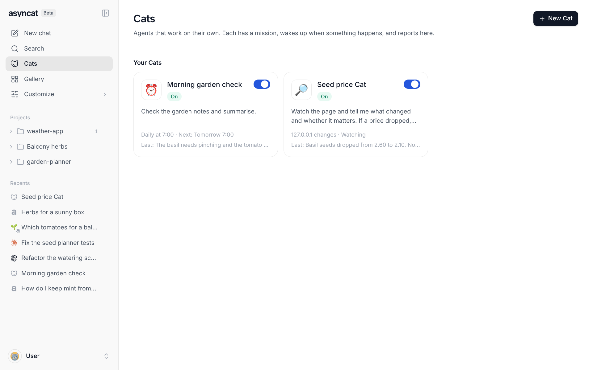 |
| **One chat box**: pick who answers (Asyncat, Claude Code, Codex or an ACP agent), this chat's model, a project and Plan or Action. | **Cats**: agents that work on their own, each with a mission, what wakes it, and what it did last. |
| 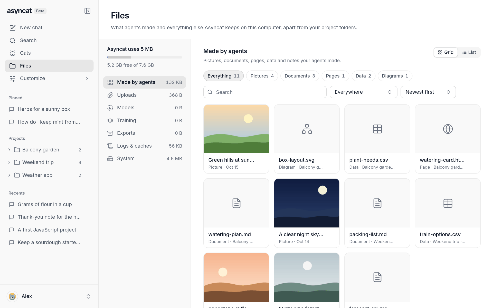 | 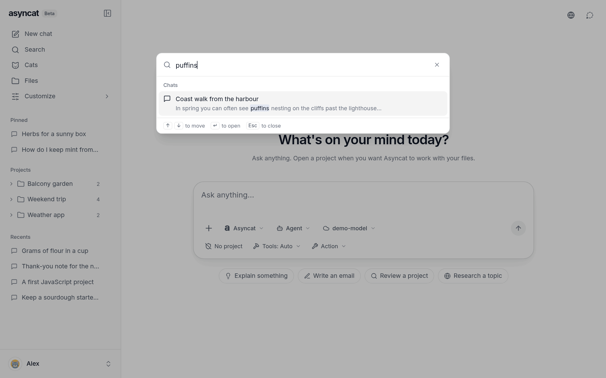 |
| **Files**: everything agents made, from any project, agent or Cat, with a viewer for each, and everything else Asyncat keeps. | **Search**: `Cmd/Ctrl+K` finds words said in your chats and opens the chat at that message. |
|  | 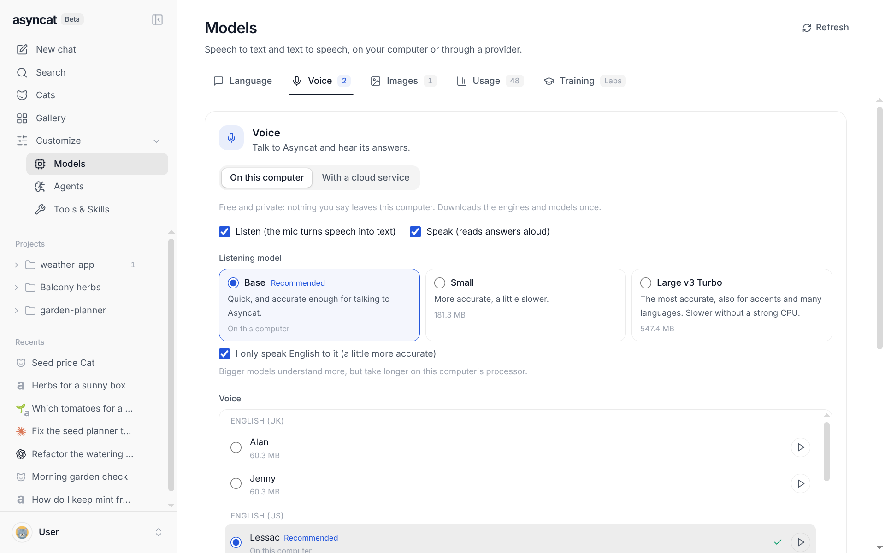 |
| **Models**: the default model for new chats, providers, local models, voice, images, usage and training. | **Voice**: listening and reading aloud in one column, with sizes shown before anything downloads. |
| 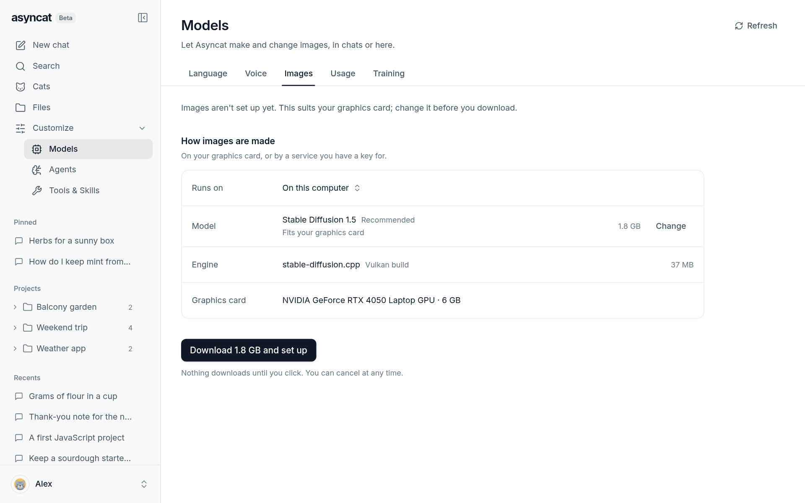 | 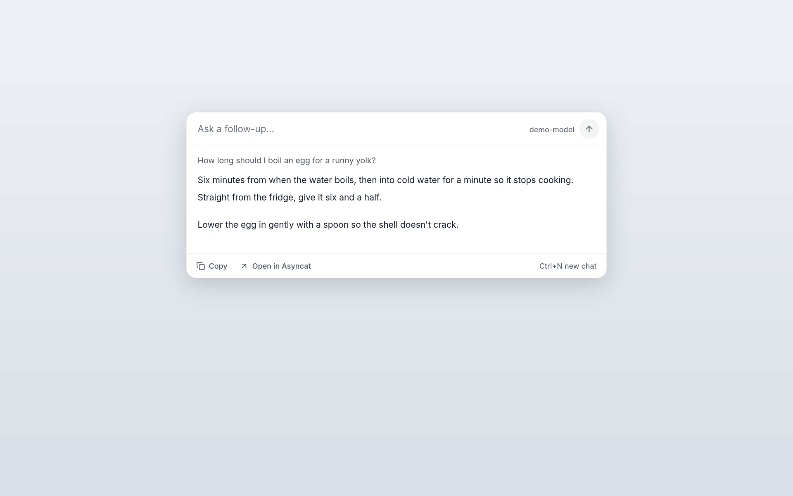 |
| **Images**: where pictures are made, and the model that suits your graphics card, with its size, before anything downloads. | **Quick ask**: a small window over any app that answers in place and saves the chat. |
| 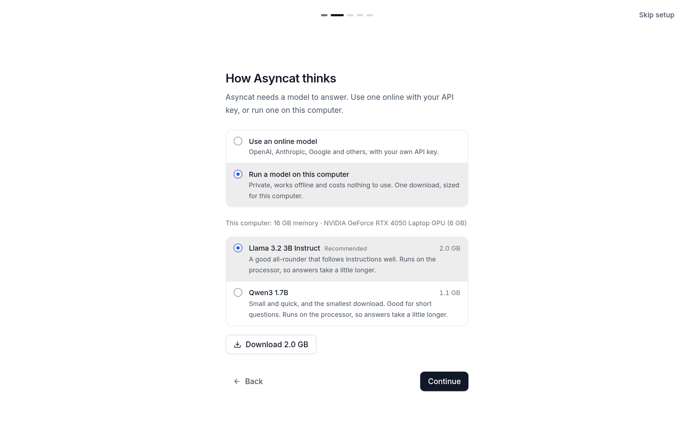 | 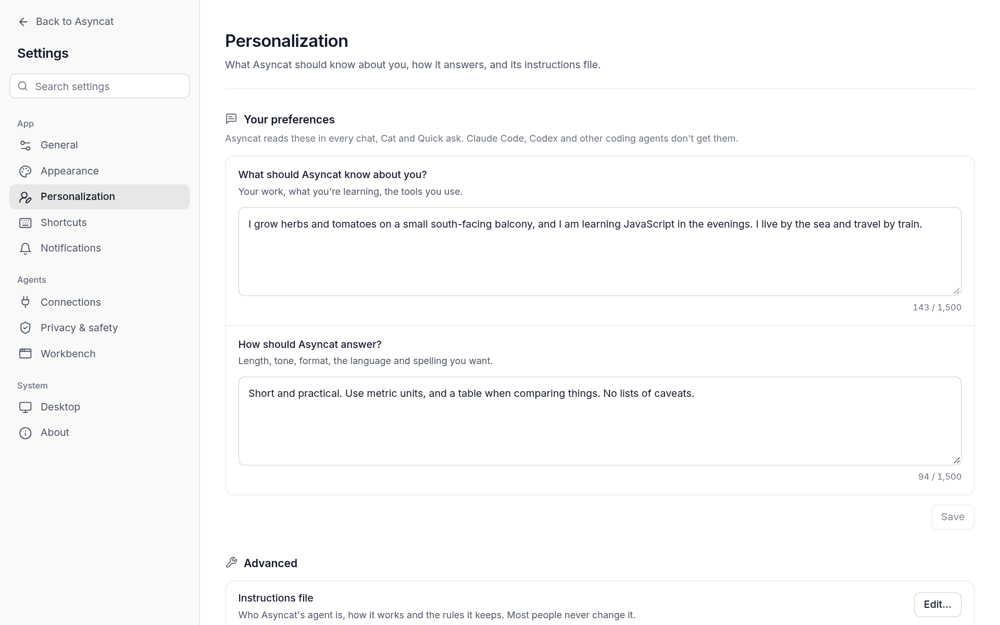 |
| **First-run setup**: a model that fits this computer or a provider, your old chats, and how careful Asyncat is. | **Personalization**: what Asyncat should know about you and how it should answer, for every chat, Cat and Quick ask. |
|  | 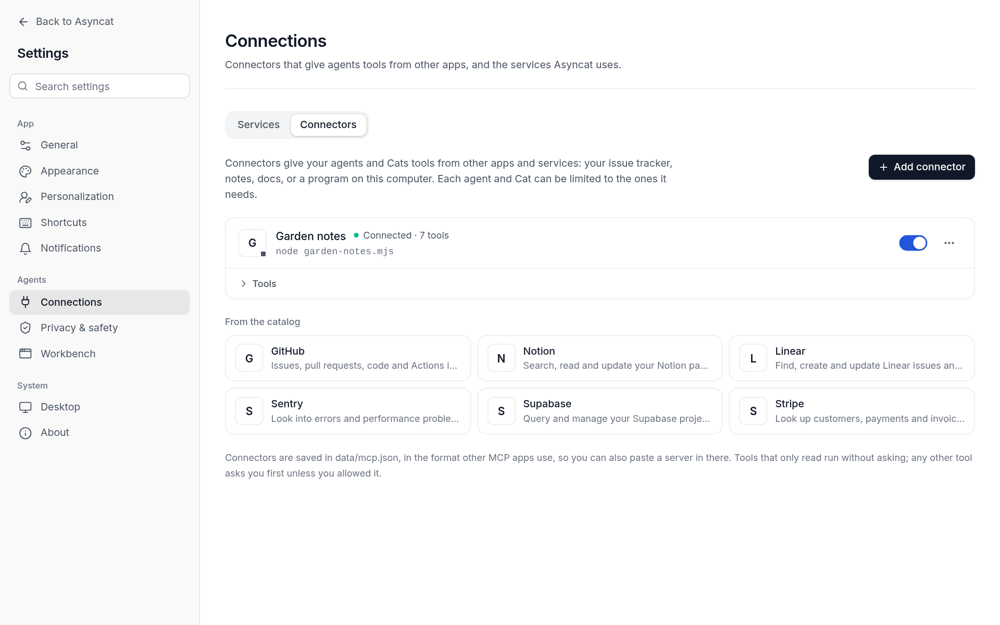 |
| **Coding agents**: Claude Code and Codex with their sign-in status, plus any Agent Client Protocol agent. | **Connectors**: tools from other apps for agents and Cats, from the catalog, a remote server or a program on this computer. |
| 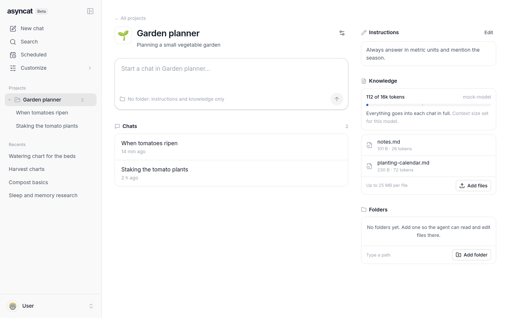 | 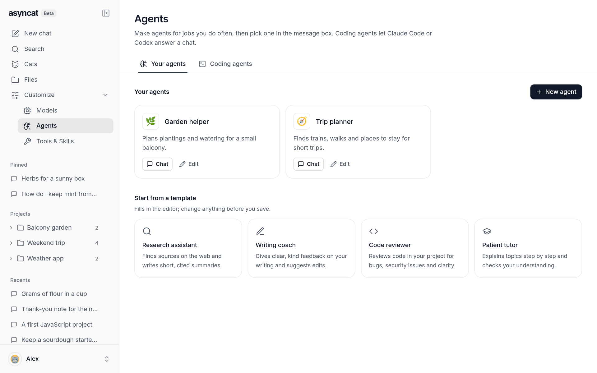 |
| **Projects**: instructions every chat follows, files the agent knows, chats, and optional folders. | **Agents**: your own agents with instructions, files, starter prompts, abilities, connectors and a model. |
| 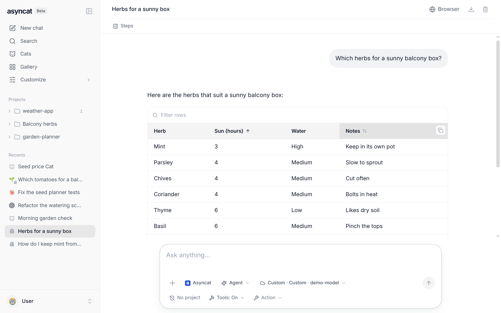 | 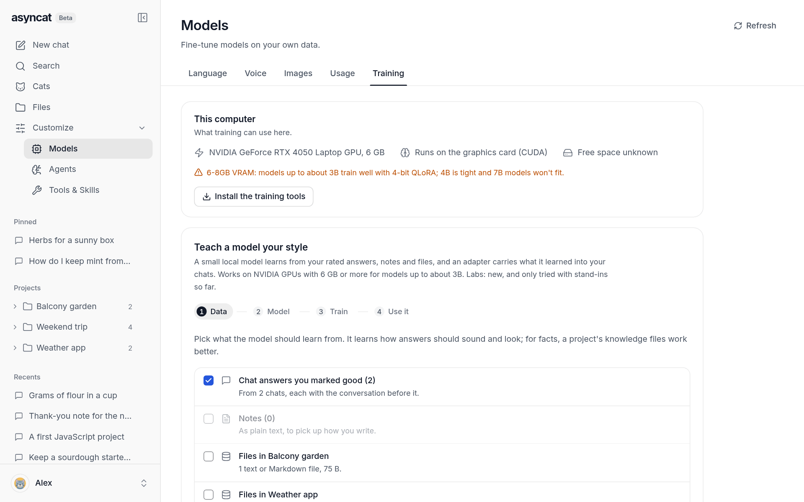 |
| **Interactive answers**: tables sort and filter, and follow-up buttons send the next message. | **Training (Labs)**: what your graphics card can train, and the answers, notes and files it learns from. |
| 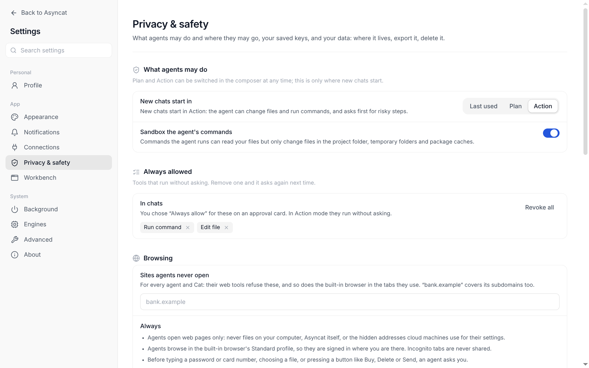 | 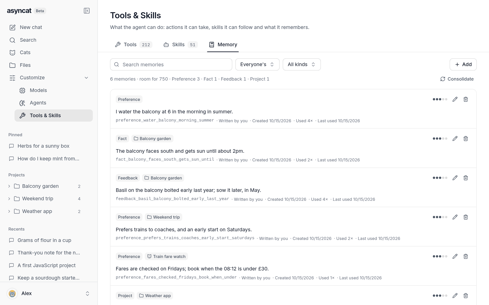 |
| **Privacy & safety**: the command sandbox, its network, and the folders commands can't read. | **Memory**: whose each memory is, filtered by project, agent or Cat; edit or add your own. |
|  | |
| **Updates** download, get checked against the release checksums, and install from inside the app. | |

---

## Why a desktop app?

Moving from a web app to a native desktop app unlocks things that aren't possible in a browser:

- **Global keyboard shortcut** — `Cmd/Ctrl+Shift+A` brings Asyncat up from anywhere on your machine, whether you're in a code editor, a terminal, or a browser. No alt-tabbing to find the right tab. If it clashes with a shortcut you use, pick another combination or turn it off in **Settings → Shortcuts**.
- **System tray** — Quick ask is one click away in your menu bar. While a Cat is on, closing the window leaves Asyncat running in the tray so the Cat still works; otherwise closing the window quits it (on macOS it stays in the Dock as usual). **Settings → General** changes this to always keep running or always quit, and can start Asyncat at login, hidden in the tray.
- **Native notifications** — When a chat or Cat finishes, asks you something, or needs approval, you get a real OS notification, not a browser popup that requires a permission grant.
- **No browser security sandbox** — Screen capture, keyboard control, OCR, and desktop automation tools run without the restrictions that a browser tab imposes.
- **Single instance** — One Asyncat, always. The OS prevents you from accidentally opening duplicates.
- **Auto-restart backend** — If the backend crashes, Electron detects it and restarts it automatically. No terminal babysitting.
- **Native menus** — Standard keyboard shortcuts (`Cmd+N` for new chat, `Cmd+,` for settings) work as expected, integrated into the OS menu bar.

---

## Quick Start

### Requirements

**Pre-built installers:** no prerequisites. Download, open, run.

**Run from source:** Node.js `22.13+` or `24+`; npm; git.

### Install & Run

#### 1. Pre-built Installers (Easiest)

Download the latest native package for your system from the **Releases** page:

- **macOS**: `.dmg` (Intel x64 or Apple Silicon arm64)
- **Windows**: `.exe` (x64 NSIS installer)
- **Linux**: `.AppImage` or `.deb` (x64)

> See [Code Signing Warnings](#-code-signing-warnings) below — macOS and Windows will show a security warning on first launch. This is expected for unsigned open-source software. The workarounds are straightforward.

#### 2. Run from Source (Developer Mode)

```bash
# Clone the repository
git clone https://github.com/asyncat-oss/asyncat-oss.git
cd asyncat-oss

# Install dependencies
npm install

# Launch dev server + Electron app
npm run electron:dev

# Same launch with docked Developer Tools opened automatically
npm run electron:dev:tools
```

In dev mode Electron loads the frontend from the Vite dev server (`localhost:8717`), so you get hot module replacement, and uses the backend that `npm run dev:backend` runs on port 8716 in Node's watch mode, which restarts when you edit `den/`. Developer Tools are also available at any time from **View → Toggle Developer Tools**.

To work in a regular browser instead, `npm run dev` starts only the backend and the Vite dev server.

Tests:

```bash
npm test -w den          # backend
npm test -w neko         # frontend
npm run test:release     # desktop app and release scripts
npm run test:e2e         # end-to-end smoke test in a headless browser
```

The end-to-end test starts a throwaway copy of Asyncat (its own data folder and ports) with a fake model, a fake MCP server and a fake ACP agent, and clicks through chat, projects, agents, Cats, connectors, Privacy & safety, training, Files and the main pages. It needs a Chromium-based browser (Chrome, Chromium, Edge or Brave) and never touches your data.

#### 3. Build & Package Distributables

```bash
# Build for your current OS
npm run electron:build

# Target specific platforms
npm run electron:build:mac
npm run electron:build:win
npm run electron:build:linux
```

Output packages go into the `release/` directory.

> Native-build note: build on the same OS and CPU architecture as the target. The backend includes native SQLite and Canvas modules, so relabeling a cross-compiled package is unsafe. GitHub Actions builds every published target on a matching native runner.

### Publishing a release

The three package versions (`package.json`, `den/package.json`, and `neko/package.json`) must match the tag. Bump all three, then validate them before tagging (replace `vX.Y.Z-beta.N` with the new version):

```bash
npm install --package-lock-only
npm run release:validate -- vX.Y.Z-beta.N
git tag vX.Y.Z-beta.N
git push origin vX.Y.Z-beta.N
```

The release workflow builds and verifies each native package, creates SHA-256 checksums, and publishes all installers to one GitHub Release. Tags containing a suffix such as `-beta.1` become GitHub prereleases.

---

## Upgrading

### Source installs

```bash
git pull
npm install
npm run electron:dev
```

### Pre-built installers

Asyncat checks published GitHub releases after launch and every six hours. When a newer version exists, the profile menu shows **Update available**; it opens an update screen with the release notes. Asyncat downloads the file for your OS and CPU and checks it against the release's `SHA256SUMS.txt`. Then an AppImage replaces itself and restarts, and Windows runs the installer silently and reopens. On macOS and with the `.deb` package the file is saved to Downloads for the last step: drag it into Applications, or `sudo apt install ./file.deb`. Settings and local data stay in the OS user-data directory.

Builds are unsigned, so macOS asks once before opening a new version; see [Code Signing Warnings](#-code-signing-warnings). Updates never touch your chats, settings or Project folders.

### Uninstalling on Windows

Open **Settings → Desktop → Uninstall Asyncat**, use the **Uninstall Asyncat** shortcut in the Start menu, or open **Windows Settings → Apps → Installed apps → Asyncat → Uninstall**. During an interactive uninstall, choose whether to keep local conversations and settings for a later reinstall or remove Asyncat's local data for a clean uninstall. Attached Project folders stored outside Asyncat's local data folder are not removed.

---

## ⚠️ Code Signing Warnings

asyncat is open-source and does not pay for Apple or Microsoft code signing certificates. When you install a pre-built release, your OS will complain. These are the workarounds:

### macOS

macOS will show: *"Asyncat.app can't be opened because Apple cannot check it for malicious software."*

**Option A (easiest):** Right-click (or Ctrl+click) `Asyncat.app` → choose **Open**. A dialog appears with an **Open** button. Click it.

**Option B:** Open **System Settings** → **Privacy & Security** → scroll to the Security section → click **Open Anyway**.

**Option C (terminal):**
```bash
xattr -cr /Applications/Asyncat.app
```

### Windows

Windows Defender SmartScreen will show: *"Windows protected your PC."*

1. Click **More info**
2. Click **Run anyway**

It only asks once. After that, The Cat is free.

### Linux

No warnings. Linux trusts you to manage your own computer.

```bash
chmod +x Asyncat-*.AppImage
./Asyncat-*.AppImage
```

---

## Keyboard Shortcuts

| Shortcut | Action |
|---|---|
| `Cmd/Ctrl+Shift+A` | Summon or hide Asyncat (global — works in any app) |
| `Cmd/Ctrl+Shift+Space` | Quick ask (global; or run Asyncat with `--quick-ask`) |
| `Cmd/Ctrl+K` | Search: jump to a page, or find chats (by name or by what was said in them), projects, notes and memories |
| `Cmd/Ctrl+N` | New chat |
| `Cmd/Ctrl+,` | Settings |
| `Cmd/Ctrl+Shift+R` | Restart backend |
| `Cmd/Ctrl+R` | Reload window |
| `Shift+F5` | Force reload window (ignore cache) |

Page navigation shortcuts (`Cmd/Ctrl+1` for chat, `Cmd/Ctrl+2` for all chats, `Cmd/Ctrl+4` for Cats…) and the two global shortcuts can be changed in **Settings → Shortcuts**. The global ones can also be turned off.

---

## After Install

### 1. Set up a model

The first time Asyncat opens, a short setup asks your name, then offers a model to run on this computer (it names your memory and graphics card, says how well the model fits and how much it downloads) or a provider to connect. Next it can bring in your ChatGPT or Claude chats, and lets you choose how careful Asyncat is: whether new chats start in Plan or Action, and whether the agent's commands run in the sandbox and with what network. **Skip setup** leaves it at any point; **Settings → General → Run setup again** brings it back.

To add or change a model later, go to **Customize → Models → Language**:

- **Local**: under **Local models**, load a GGUF model with the built-in llama.cpp engine (models already in your Hugging Face cache are listed too), or connect Ollama, LM Studio, MLX or another local server under **Add provider**. The last model you loaded is loaded again when Asyncat starts
- **Cloud**: under **Add provider**, search for OpenAI, Anthropic, Gemini, OpenRouter and others and add your key. Asyncat lists the provider's models so you can pick one before saving

### 2. Open a chat

Start a **New chat** and type. Under the message box you can choose:

- **Who answers**: Asyncat's own agent with your model, or Claude Code or Codex if they are installed and signed in on this computer
- **Model**: the model for this chat. Picking one changes this chat only, and new chats start with the model you picked last
- **Agent**: one of your agents, with its instructions, files and model
- **Tools**: Auto, Always use tools, or Just chat
- **Project**: a project's instructions and files, and optionally one of its folders for the agent to work in
- **Mode**: **Plan** (read-only; proposes changes without making them), **Action** (full ReAct execution loop, asks before risky tools, up to 25 rounds by default) or **Yolo** (Action with every tool auto-approved)

For a chat that shouldn't be kept, press the dashed chat bubble at the top of a new chat: a **Temporary chat** isn't saved and teaches Asyncat nothing. `Cmd/Ctrl+K` finds any chat by its name or by what was said in it, and **Pin** in a chat's menu keeps it at the top of the sidebar.

### 3. Set up projects and agents

Open **Projects** in the sidebar and create one. On its page, add **instructions** (for example "answer in British English, use metric units") and **files** the agent should know, and start a chat from there. Add a folder when the agent should work with files on your computer. The bar under the files shows how much of the current model's context window they take: when they don't all fit, the agent searches them for each question instead.

Open **Customize → Agents** to make an agent: start from a template or a blank one, give it instructions, files, starter prompts, what it may do and, if you like, its own model. Pick it in the message box; its starter prompts show on a new chat.

### 4. Set up Cats

Open **Cats** in the sidebar and make one: its mission, what wakes it (a schedule, new email, a feed or web page that changes, a file in a folder), its brain (an agent, a model, a project), and how free it is. Or just ask in a chat: "every Monday at 9, list what changed in my project last week". Each run reports in the Cat's chat; questions and steps that need your OK wait in the inbox at the top of the Cats page. Old scheduled tasks were turned into Cats on the first start of this version.

### 5. Connect your apps

**Settings → Connections → Connectors** adds tools from other apps: pick one from the catalog, sign in, and agents and Cats can use it. Limit an agent or a Cat to the connectors it needs in its settings.

### 6. Make it yours

- **Settings → Personalization** has two short fields, **What should Asyncat know about you?** and **How should Asyncat answer?**, that every chat, Cat and Quick ask reads (Claude Code, Codex and ACP agents don't). Under **Advanced**, the instructions file sets who the agent is and the rules it keeps; your edits are kept apart from the file Asyncat ships, and **Reset to default** brings that back.
- **Customize → Tools & Skills** browses the tools, loads skills (grouped as Planning, Workflow, Recall, Risk checks, Habits and Tone), and shows memories by project, agent or Cat (edit or add your own).
- **Settings → Privacy & safety** sets the command sandbox, revokes always-allowed tools, lists sites agents never open, turns learning from chats on or off, imports your ChatGPT or Claude chats, and exports or deletes everything.
- The other Settings pages: **General** (your name and picture, where new chats start, what closing the window does, running setup again), **Appearance** (theme, motion and what the sidebar shows), **Shortcuts**, **Notifications** (what notifies you, with quiet hours), **Connections** (connectors and the services Asyncat uses), **Workbench** (the browser and terminal beside your chats), **Desktop** (the pet, Quick ask and Asyncat's data folder) and **About** (version, updates and developer options). The search box at the top of Settings finds any setting.

---

## Architecture

```text
asyncat-oss/
├── electron/        # Electron desktop app wrapper (see electron/README.md)
│   ├── main.js      #   App entry: boot sequence, IPC, global shortcuts, static frontend server
│   ├── backend.js   #   Spawns den (bundled Node.js when packaged, system Node in dev)
│   ├── window.js    #   BrowserWindow creation and loading screen
│   ├── tray.js      #   System tray icon and menu
│   ├── background.js #  Keep running in the tray for Cats, start at login
│   ├── quick.js     #   Quick ask window (shows the app's /quick page)
│   ├── pet.js       #   Optional desktop companion that shows agent status
│   ├── updater.js   #   Update checks, download, checksum and install (update-install.js)
│   ├── menu.js      #   Native OS menu bar
│   ├── shortcuts.js #   System-wide shortcuts (settings in shortcut-config.js)
│   ├── preload.js   #   Secure renderer ↔ main bridge
│   └── constants.js #   Paths, ports, platform flags
├── den/             # Backend — Express API + Agent Runtime
│   ├── src/
│   │   ├── index.js           # Server entry (routes, DB, CORS, SSE streaming)
│   │   ├── agent/             # AgentRuntime, tools, skills, skill suggestions, souls, sessions,
│   │   │                      #   the command sandbox, copies (SandboxManager), profiles, ACP client (agent/acp)
│   │   ├── ai/                # Providers, local engines, chat/agent/training routes
│   │   ├── boot/              # Runs first at start: a requested "Delete everything"
│   │   ├── browser/           # Built-in browser history (/api/browser)
│   │   ├── cats/              # Cats: store, clock and triggers, runs, inbox (/api/cats)
│   │   ├── config/            # Config + secrets API (/api/config)
│   │   ├── connectors/        # MCP connectors: config, OAuth, download checks (/api/connectors)
│   │   ├── db/                # SQLite client + schema
│   │   ├── files/             # File explorer service (/api/files)
│   │   ├── importers/         # ChatGPT and Claude exports (/api/import)
│   │   ├── install/           # Runtime readiness checks (/api/install)
│   │   ├── integrations/      # RSS, mail, outbound notifications
│   │   ├── knowledge/         # Project and agent files: text extraction, search, context sizing
│   │   ├── lib/               # Shared helpers: .env I/O, system deps, engine installs, secret encryption
│   │   ├── made/              # Where agents' files and notes are found, for Files → Made by agents
│   │   ├── media/             # Voice and picture setup, the picture gallery (/api/media)
│   │   ├── middleware/        # Local profile context, cross-site request guard
│   │   ├── notes/             # Delta-based notes, export (/api/notes)
│   │   ├── privacy/           # Blocked sites, export everything, delete everything (/api/privacy)
│   │   ├── search/            # Universal search, including words inside chats (/api/search)
│   │   ├── setup/             # First-run setup: its state and the local model it offers (/api/setup)
│   │   ├── storage/           # Files: places, items, sizes and clean-ups (/api/storage); uploaded files (/files)
│   │   ├── training/          # Guided training: data, plans, adapters (/api/training/guide)
│   │   ├── update/            # Update status and graceful restart (/api/update)
│   │   └── users/             # Local profile + workspace/project CRUD
│   ├── data/                  # SQLite DB, uploads, connectors, adapters (created at runtime)
│   └── test/                  # node:test suites (npm test -w den)
├── neko/            # React + Vite frontend
│   └── src/
│       ├── CommandCenter/     # Chat and agent runs
│       ├── Agent/             # Agents page (your agents and the agent editor, coding agents)
│       ├── Models/            # LLM providers, local models and runtimes, audio, images
│       ├── Cats/              # Cats page, a Cat's page, the inbox
│       ├── Connectors/        # Settings → Connections → Connectors
│       ├── Tools/             # Tools & skills browser, the Memory page
│       ├── Training/          # Guided training (shown as Models → Training)
│       ├── files/             # Files: what agents made and everything else Asyncat keeps
│       ├── Settings/          # Settings tabs
│       ├── projects/          # Projects: instructions, files, chats and folders
│       ├── sidebar/           # Sidebar, Claude Code & Codex sessions, Cmd/Ctrl+K search
│       ├── components/        # Shared UI pieces (components/ui) and the update screen
│       ├── welcome/           # First-run setup (/welcome)
│       ├── quick/             # Quick ask (/quick), shown in the desktop app's Quick ask window
│       └── notes/             # Notes editor (opened from note documents in chat)
├── scripts/         # Install, icon, Node bundling, and release scripts
├── build/           # Windows installer customization (installer.nsh)
└── electron-builder.yml # Electron desktop packaging configuration
```

### How the desktop app boots

```text
Electron starts
  → electron/main.js — single-instance lock, IPC, updater, menu, tray, global shortcuts
    (registered from the user's settings by electron/shortcuts.js)
  → creates the window and shows the loading screen
  → electron/backend.js — spawns den/src/index.js (bundled Node.js when packaged,
    system Node in dev; dev scripts reuse the watch-mode backend instead), passing
    a per-launch bridge token and the keychain-held key for saved secrets
  → polls /health until the backend is ready (30s timeout; on failure a dialog
    offers the diagnostic logs and the app continues)
  → starts the static frontend server (neko/dist/) on port 8717 unless Vite is running
  → BrowserWindow loads http://127.0.0.1:8717 (packaged) or http://localhost:8717 (Vite)
  → connects the backend ↔ desktop bridge (/api/host): notifications, Cat state
    and the built-in browser, which runs in the desktop app
```

### Agent runtime flow

```text
User goal
  → AgentRuntime.run() — ReAct loop (up to 25 rounds)
  → System prompt: instructions file + skills + memory + capabilities + your preferences
  → Core tool set for the task; tool_search loads others on demand
  → The chat's own model, from any provider (local or cloud)
  → Tool execution with permission guards; commands run in the OS sandbox
  → After the answer: memories from the chat, and a skill suggestion if turned on
  → AgentSession persists audit trail
  → Results streamed to browser via SSE
```

---

## Learning from chats

**Settings → Privacy & safety → Learning from chats** has two switches:

- **Remember things from chats** (on): after a run that used tools, one short request to the model picks out lasting facts and preferences worth keeping, and corrections ("no, use the other folder") are kept as feedback. Off, the agent saves a memory only when you ask. **Tools & Skills → Memory** shows and edits what it remembers.
- **Suggest skills from my chats** (off): after a chat where the agent worked through a task with several steps, one more request drafts a skill from them. The chat shows **Save this as a skill?** with its name and description; **Save** writes it to `~/.asyncat/skills`, **Not now** drops it. A chat keeps one draft at a time, and turning the switch off drops any that are waiting.

Temporary chats never learn anything. Cats and helper agents don't suggest skills.

---

## The command sandbox

Commands the agent runs (the shell, tests, builds, linters, package managers and programs it starts) go through the sandbox your operating system already has: bubblewrap (`bwrap`) on Linux and `sandbox-exec` on macOS. Claude Code and Codex use the same approach. There is no virtual machine, so nothing extra downloads and commands run at full speed with the tools you have installed. **Settings → Privacy & safety → Commands the agent runs** shows whether it is working and sets the rest.

- **What commands can change**: the project folder, temporary folders and package caches. Folders on your `PATH`, such as `~/.cargo`, stay read-only, so a command can't leave a program there for later.
- **What commands can't read**: sign-ins, keys, browser profiles and Asyncat's own data (for example `~/.ssh`, `~/.aws`, `~/.config/gh`) look empty to them. **Allow** gives one back when a tool needs it, such as `~/.ssh` for Git over SSH.
- **Your saved keys**: API keys you saved in Asyncat are never passed to programs the agent starts.
- **Network**: **Open** (the default) lets commands use the network like any program. **Package registries only** lets them download packages from npm, PyPI, crates.io and the like, and nothing else. **Off** gives them no network, though a model server on this computer stays reachable. On Linux the two limited modes need `socat`; without it, commands get no network at all, and Settings says so.
- **When it can't start**: if `bwrap` is missing or blocked (Ubuntu 24.04 and later block it with AppArmor by default), commands don't quietly run without it: every command asks first, every time, and the approval card says why. Windows has no sandbox for commands yet: there, commands can change any file your account can, and ask first unless a parser proves them read-only.
- **Copies**: to try something risky, the agent can work in a copy of the project and show you the diff before anything comes back.

---

## Troubleshooting

### "Backend Start Failed" or a blank window

The backend or the frontend server could not start. Check:

1. **Are ports 8716 (backend) and 8717 (frontend) free?** `lsof -i :8716 -i :8717` (macOS/Linux) or `netstat -ano | findstr "8716 8717"` (Windows).
2. **Read the backend log**: `den/logs/backend-process.log` from source, or `logs/backend-process.log` in Asyncat's user-data folder for installed builds (the error dialog's **Open diagnostic logs** button opens it).
3. **Open the developer console** — in the app: `View → Toggle Developer Tools` — and check for errors.

### `better-sqlite3` crashes or fails to load

The backend native modules must be compiled for the system Node.js version used during installation:

```bash
npm rebuild better-sqlite3 canvas
```

Do not rebuild these backend modules against Electron; packaged builds run them with the separately bundled Node.js runtime.

### Tray icon missing on Linux

Some Linux distributions need `libappindicator`:

```bash
sudo apt install libappindicator1
# or
sudo apt install libayatana-appindicator1
```

### Desktop updates

Packaged builds check GitHub Releases automatically and update from inside the app (see [Pre-built installers](#pre-built-installers) above): AppImage and Windows builds install and restart themselves, macOS and `.deb` builds get the verified file for the last step. Source installations continue to update with `git pull` and `npm install`.

---

## Status

**asyncat is a mature beta.** It has been built and tested across real agent sessions covering coding, research, system administration, agents that work on their own, and desktop automation tasks.

**Active development:**
- [ ] Multi-platform clients (Telegram, Slack)
- [ ] API/SDK for programmatic access
- [ ] Training tested on more GPUs, and on Macs

---

## License

MIT — use it, fork it, build on it.
