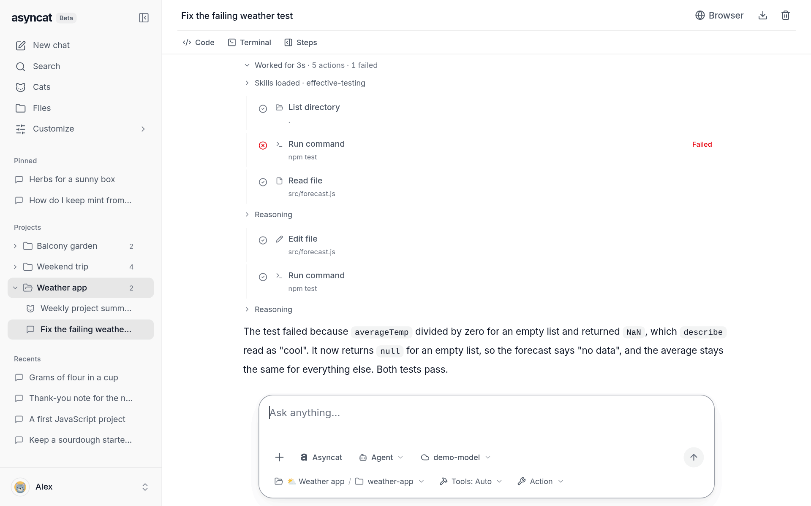
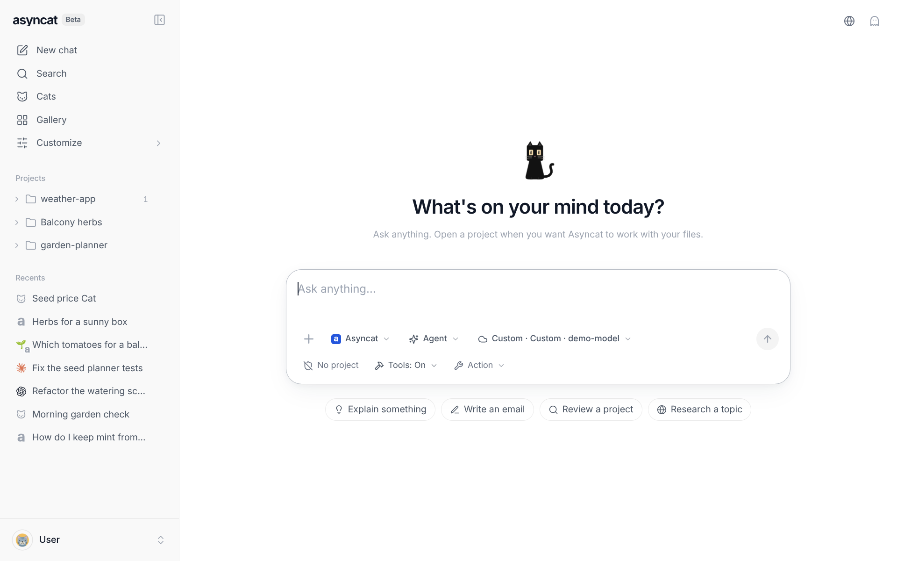
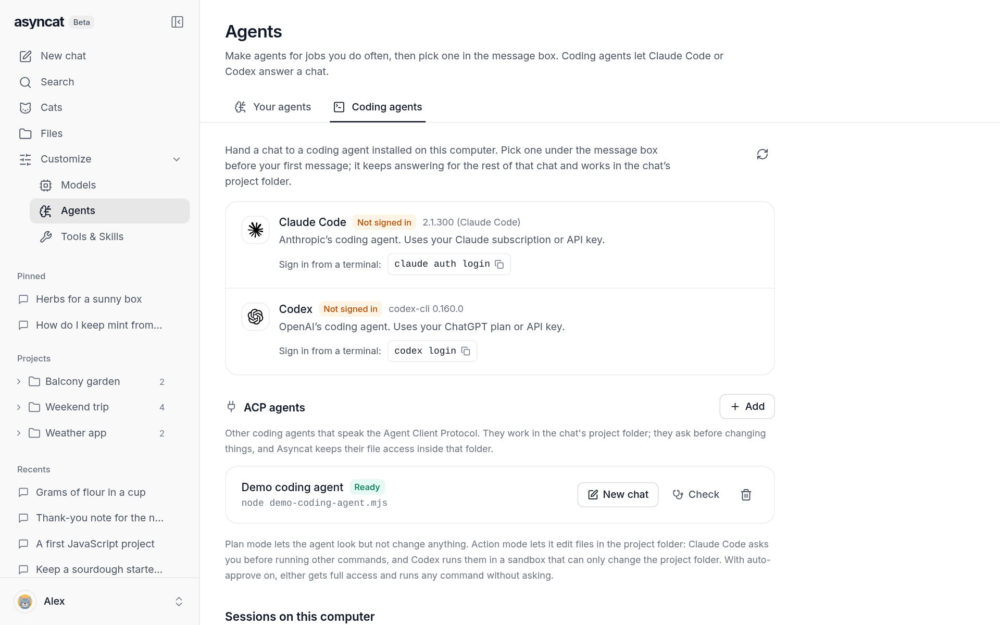
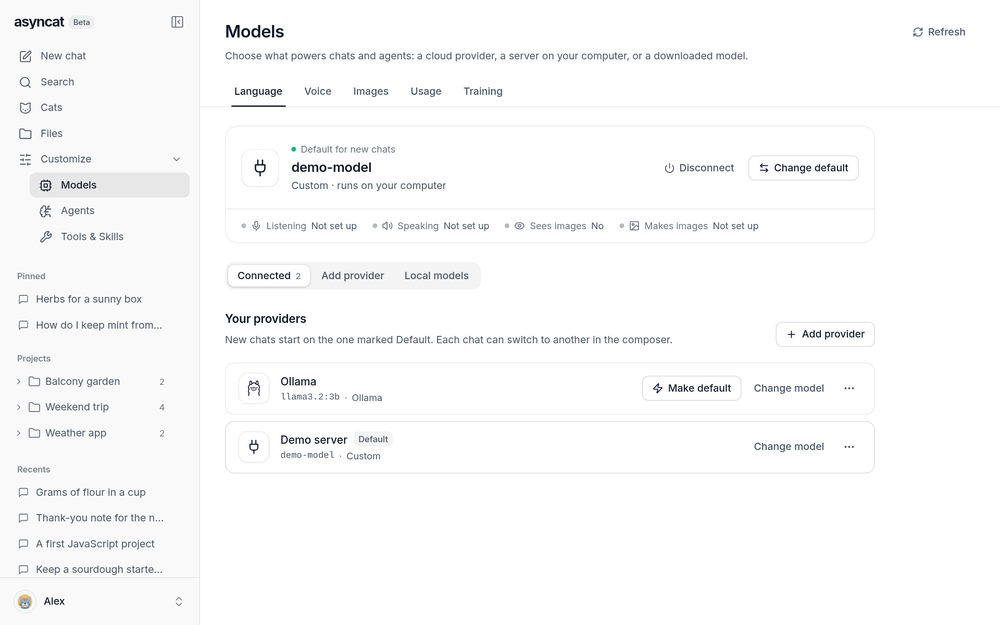
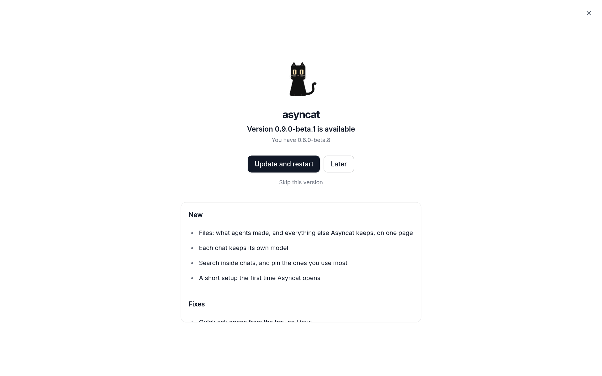

# asyncat

**A local-first AI agent desktop app.** 210+ tools. 51 skills. Self-improving. Desktop automation. Fully offline.

> **v0.8.0-beta.6** · MIT · [Install](#quick-start) · [Screenshots](#screenshots) · [Website](https://asyncat.com)



<sub>A finished agent run: what the agent did (it ran the tests, read and edited a file, ran them again) and its answer. Screenshots use a demo workspace with example chats.</sub>

---

## What asyncat is

asyncat is a full-stack AI agent you run on your own hardware as a **native desktop application** (powered by Electron). It bundles a backend API engine (`den`) and a React web interface (`neko`) into a single installable app. You connect any model — local or cloud — and it can do real work on your machine.

It is not a chatbot wrapper. It controls your screen, writes and runs code, manages files, schedules recurring jobs, and gets better over time through a self-improving engine called Basal Ganglia.

---

## What's inside

| | |
|---|---|
| **210+ tools** | Files, shell, git, browser, Docker, screen, keyboard, semantic memory, RAG, notes, system, network, audio, image, design canvases, code analysis, sandboxes, scheduler, workflows, model management, integrations |
| **51 bundled skills** | Reusable instruction modules: code review, debugging, TDD, deployment, security audit, incident response, data engineering, and more |
| **Basal Ganglia** | Watches which tools succeed for which kinds of goals. After 3 successful runs of the same goal pattern with the same set of tools it writes a new skill automatically. No annotation, no config |
| **One chat box** | Chat and agent work happen in the same place. The **Tools** setting decides per message: **Auto** runs the agent when the model supports tools or a project, file or mention is involved; **Just chat** talks to the model directly; **Always use tools** always runs the agent. The agent works in `plan` (read-only tools), `action` (full ReAct loop, asks before risky tools) or **Yolo** (`action` with auto-approve). A `design` mode (canvases, artifacts and images; no source edits or shell/git writes) is available through the API |
| **Claude Code and Codex** | Hand a chat to Claude Code or Codex installed on your computer, signed in with your own account. Pick one, and its model, under the message box; follow-ups continue the same session and its steps show in the chat. Your existing Claude Code and Codex sessions (from the terminal or their apps) are listed in the sidebar: open one and carry on where you left off. In Action mode Claude Code asks through the usual approval card before running commands. **Customize → Agents → Coding agents** shows install and sign-in status, plan usage limits, and every session |
| **Approvals** | Before a risky tool runs, the agent asks: approve once, trust it for the rest of the run, or always allow. File edits show the diff before you decide |
| **Small prompts for local models** | Each agent step sends a core set of tools (about 40, or 24 for models that read tools from the prompt) instead of the full list. The agent finds the rest with `tool_search` when it needs them |
| **35+ providers** | OpenAI, Anthropic, Gemini, Ollama, llama.cpp, MLX, LM Studio, OpenRouter, DeepSeek, Groq, Together AI, Mistral, Perplexity, Cohere, and more |
| **Agent profiles** | Bundle a soul, working directory, tool permissions, and max rounds into named configurations. Switch profiles per task |
| **Desktop automation** | Click, type, read screen content via OCR, focus windows — controls your actual machine |
| **Sandboxes** | Isolated workspace copies. Review changes as a unified diff. Apply or discard. Commit to a branch |
| **Automations** | Workflows, Schedules and Activity under one sidebar entry. Chain agent steps into a saved workflow and run it on demand or on a schedule, under any agent profile; each step can pass its output to the next. Schedule single agent jobs too, and follow every run in one feed. The agent can trigger workflows itself |
| **Command palette** | `Cmd/Ctrl+K` from anywhere — jump to any page, or search projects, notes, chats, and memory |
| **Semantic memory** | Recall by meaning, not just keywords. Uses your provider's embeddings when available, falls back to an offline keyword (hashed lexical) index |
| **Built-in browser** | A real tabbed browser the agent shares. Hand it the page you're on with one click, or let it browse on its own |
| **MCP support** | Add stdio MCP servers to `data/mcp.json` in the backend data folder (`den/data/mcp.json` from source, `<user data>/data/mcp.json` when installed). It is created on first start and hot-reloaded. Also manageable through `/api/agent/mcp` (no UI yet) |
| **Persistent memory** | SQLite-backed key-value memory with types: `user`, `feedback`, `project`, `reference`, `fact`, `preference`, `context`, `task_state` |
| **Notes** | The agent writes notes as documents in the chat; open one to edit it (rich text, tables, export to DOCX/PDF). `Cmd/Ctrl+K` finds them |
| **System tray** | Left-click for quick chat, right-click to show Asyncat, restart the backend, or quit. On macOS, closing the window keeps the backend, schedules, and workflows running |
| **Global shortcuts** | `Cmd/Ctrl+Shift+A` summons Asyncat from any app; `Cmd/Ctrl+Shift+Space` opens quick chat. Change or turn off either one in **Settings → Appearance** |
| **Fine-tuning (Labs)** | **Customize → Models → Training** trains a LoRA adapter for a local model and saves it to disk. Loading the adapter is still up to you |
| **Native notifications** | System-level alerts when a background run finishes, asks you a question, or needs tool approval |
| **Fully offline** | Every feature works with local models. No data leaves your machine (installed builds only check GitHub Releases for updates) |

---

## Screenshots

| | |
|---|---|
|  |  |
| **One chat box**: pick who answers (Asyncat, Claude Code or Codex) and the model; your Claude Code and Codex sessions sit in the sidebar. | **Coding agents**: install and sign-in status, plan usage, and every Claude Code and Codex session on this computer. |
|  |  |
| **Models**: the model in use, a searchable provider directory, local models, voice, images, usage and training. | **Updates** download, get checked against the release checksums, and install from inside the app. |

---

## Why a desktop app?

Moving from a web app to a native desktop app unlocks things that aren't possible in a browser:

- **Global keyboard shortcut** — `Cmd/Ctrl+Shift+A` brings Asyncat up from anywhere on your machine, whether you're in a code editor, a terminal, or a browser. No alt-tabbing to find the right tab. If it clashes with a shortcut you use, pick another combination or turn it off in **Settings → Appearance**.
- **System tray** — Quick chat is one click away in your menu bar. On macOS, closing the window keeps the agent, schedules, and workflows running in the background; on Windows and Linux, closing the window quits Asyncat.
- **Native notifications** — When a background run finishes, asks you something, or needs approval, you get a real OS notification, not a browser popup that requires a permission grant.
- **No browser security sandbox** — Screen capture, keyboard control, OCR, and desktop automation tools run without the restrictions that a browser tab imposes.
- **Single instance** — One Asyncat, always. The OS prevents you from accidentally opening duplicates.
- **Auto-restart backend** — If the backend crashes, Electron detects it and restarts it automatically. No terminal babysitting.
- **Native menus** — Standard keyboard shortcuts (`Cmd+N` for new chat, `Cmd+,` for settings) work as expected, integrated into the OS menu bar.

---

## Quick Start

### Requirements

**Pre-built installers:** no prerequisites. Download, open, run.

**Run from source:** Node.js `22.13+` or `24+`; npm; git.

### Install & Run

#### 1. Pre-built Installers (Easiest)

Download the latest native package for your system from the **Releases** page:

- **macOS**: `.dmg` (Intel x64 or Apple Silicon arm64)
- **Windows**: `.exe` (x64 NSIS installer)
- **Linux**: `.AppImage` or `.deb` (x64)

> See [Code Signing Warnings](#-code-signing-warnings) below — macOS and Windows will show a security warning on first launch. This is expected for unsigned open-source software. The workarounds are straightforward.

#### 2. Run from Source (Developer Mode)

```bash
# Clone the repository
git clone https://github.com/asyncat-oss/asyncat-oss.git
cd asyncat-oss

# Install dependencies
npm install

# Launch dev server + Electron app
npm run electron:dev

# Same launch with docked Developer Tools opened automatically
npm run electron:dev:tools
```

In dev mode Electron loads the frontend from the Vite dev server (`localhost:8717`), so you get hot module replacement, and uses the backend that `npm run dev:backend` runs on port 8716 in Node's watch mode, which restarts when you edit `den/`. Developer Tools are also available at any time from **View → Toggle Developer Tools**.

To work in a regular browser instead, `npm run dev` starts only the backend and the Vite dev server.

#### 3. Build & Package Distributables

```bash
# Build for your current OS
npm run electron:build

# Target specific platforms
npm run electron:build:mac
npm run electron:build:win
npm run electron:build:linux
```

Output packages go into the `release/` directory.

> Native-build note: build on the same OS and CPU architecture as the target. The backend includes native SQLite and Canvas modules, so relabeling a cross-compiled package is unsafe. GitHub Actions builds every published target on a matching native runner.

### Publishing a release

The three package versions (`package.json`, `den/package.json`, and `neko/package.json`) must match the tag. Bump all three, then validate them before tagging (replace `vX.Y.Z-beta.N` with the new version):

```bash
npm install --package-lock-only
npm run release:validate -- vX.Y.Z-beta.N
git tag vX.Y.Z-beta.N
git push origin vX.Y.Z-beta.N
```

The release workflow builds and verifies each native package, creates SHA-256 checksums, and publishes all installers to one GitHub Release. Tags containing a suffix such as `-beta.1` become GitHub prereleases.

---

## Upgrading

### Source installs

```bash
git pull
npm install
npm run electron:dev
```

### Pre-built installers

Asyncat checks published GitHub releases after launch and every six hours. When a newer version exists, the profile menu shows **Update available**; it opens an update screen with the release notes. Asyncat downloads the file for your OS and CPU and checks it against the release's `SHA256SUMS.txt`. Then an AppImage replaces itself and restarts, and Windows runs the installer silently and reopens. On macOS and with the `.deb` package the file is saved to Downloads for the last step: drag it into Applications, or `sudo apt install ./file.deb`. Settings and local data stay in the OS user-data directory.

Builds are unsigned, so macOS asks once before opening a new version; see [Code Signing Warnings](#-code-signing-warnings). Updates never touch your chats, settings or Project folders.

### Uninstalling on Windows

Open **Settings → About → Uninstall Asyncat**, use the **Uninstall Asyncat** shortcut in the Start menu, or open **Windows Settings → Apps → Installed apps → Asyncat → Uninstall**. During an interactive uninstall, choose whether to keep local conversations and settings for a later reinstall or remove Asyncat's local data for a clean uninstall. Attached Project folders stored outside Asyncat's local data folder are not removed.

---

## ⚠️ Code Signing Warnings

asyncat is open-source and does not pay for Apple or Microsoft code signing certificates. When you install a pre-built release, your OS will complain. These are the workarounds:

### macOS

macOS will show: *"Asyncat.app can't be opened because Apple cannot check it for malicious software."*

**Option A (easiest):** Right-click (or Ctrl+click) `Asyncat.app` → choose **Open**. A dialog appears with an **Open** button. Click it.

**Option B:** Open **System Settings** → **Privacy & Security** → scroll to the Security section → click **Open Anyway**.

**Option C (terminal):**
```bash
xattr -cr /Applications/Asyncat.app
```

### Windows

Windows Defender SmartScreen will show: *"Windows protected your PC."*

1. Click **More info**
2. Click **Run anyway**

It only asks once. After that, The Cat is free.

### Linux

No warnings. Linux trusts you to manage your own computer.

```bash
chmod +x Asyncat-*.AppImage
./Asyncat-*.AppImage
```

---

## Keyboard Shortcuts

| Shortcut | Action |
|---|---|
| `Cmd/Ctrl+Shift+A` | Summon or hide Asyncat (global — works in any app) |
| `Cmd/Ctrl+Shift+Space` | Quick chat popup (global) |
| `Cmd/Ctrl+K` | Command palette: jump to a page or search |
| `Cmd/Ctrl+N` | New chat |
| `Cmd/Ctrl+,` | Settings |
| `Cmd/Ctrl+Shift+R` | Restart backend |
| `Cmd/Ctrl+R` | Reload window |
| `Shift+F5` | Force reload window (ignore cache) |

Page navigation shortcuts (`Cmd/Ctrl+1`…) and the two global shortcuts can be changed in **Settings → Appearance**. The global ones can also be turned off.

---

## After Install

### 1. Add a provider

Go to **Customize → Models → Language**:

- **Local**: under **Local models**, load a GGUF model with the built-in llama.cpp engine (models already in your Hugging Face cache are listed too), or connect Ollama, LM Studio, MLX or another local server under **Add provider**. The last model you loaded is loaded again when Asyncat starts
- **Cloud**: under **Add provider**, search for OpenAI, Anthropic, Gemini, OpenRouter and others and add your key. Asyncat lists the provider's models so you can pick one before saving

### 2. Open a chat

Start a **New chat** and type. Under the message box you can choose:

- **Who answers**: Asyncat's own agent with your model, or Claude Code or Codex if they are installed and signed in on this computer
- **Tools**: Auto, Always use tools, or Just chat
- **Project**: a folder the agent can work in
- **Mode**: **Plan** (read-only; proposes changes without making them), **Action** (full ReAct execution loop, asks before risky tools, up to 25 rounds by default) or **Yolo** (Action with every tool auto-approved)

### 3. Run scheduled tasks

Go to **Automations → Schedules** and create repeating agent jobs — hourly checks, a daily report at a set time — or put a workflow on a schedule.

### 4. Manage skills and memory

Go to **Customize → Tools & Skills** to browse the tool inventory, load skill modules, edit agent soul, and review memory entries.

---

## Architecture

```text
asyncat-oss/
├── electron/        # Electron desktop app wrapper (see electron/README.md)
│   ├── main.js      #   App entry: boot sequence, IPC, global shortcuts, static frontend server
│   ├── backend.js   #   Spawns den (bundled Node.js when packaged, system Node in dev)
│   ├── window.js    #   BrowserWindow creation and loading screen
│   ├── tray.js      #   System tray icon and menu
│   ├── popup.js     #   Quick-chat popup
│   ├── pet.js       #   Optional desktop companion that shows agent status
│   ├── updater.js   #   Update checks, download, checksum and install (update-install.js)
│   ├── menu.js      #   Native OS menu bar
│   ├── shortcuts.js #   System-wide shortcuts (settings in shortcut-config.js)
│   ├── preload.js   #   Secure renderer ↔ main bridge
│   └── constants.js #   Paths, ports, platform flags
├── den/             # Backend — Express API + Agent Runtime
│   ├── src/
│   │   ├── index.js           # Server entry (routes, DB, CORS, SSE streaming)
│   │   ├── agent/             # AgentRuntime, BasalGanglia, tools, skills, souls,
│   │   │                      #   sessions, SandboxManager, Scheduler, profiles
│   │   ├── ai/                # Providers, local engines, chat/agent/training routes
│   │   ├── browser/           # Built-in browser history (/api/browser)
│   │   ├── config/            # Config + secrets API (/api/config)
│   │   ├── db/                # SQLite client + schema
│   │   ├── files/             # File explorer service (/api/files)
│   │   ├── install/           # Runtime readiness checks (/api/install)
│   │   ├── integrations/      # GitHub, Obsidian, RSS, mail, outbound notifications
│   │   ├── lib/               # Shared helpers: .env I/O, system deps, engine installs
│   │   ├── middleware/        # Local profile context, cross-site request guard
│   │   ├── notes/             # Delta-based notes, export (/api/notes)
│   │   ├── search/            # Universal search (/api/search)
│   │   ├── storage/           # Uploaded files (/files, /api/storage)
│   │   ├── update/            # Update status and graceful restart (/api/update)
│   │   └── users/             # Local profile + workspace/project CRUD
│   ├── data/                  # SQLite DB, uploads, MCP config (created at runtime)
│   └── test/                  # node:test suites (npm test -w den)
├── neko/            # React + Vite frontend
│   └── src/
│       ├── CommandCenter/     # Chat and agent runs
│       ├── Agent/             # Agents page (profiles, coding agents)
│       ├── Models/            # LLM providers, local models and runtimes, audio, images
│       ├── Profiles/          # Agent profiles
│       ├── Automations/       # Tab bar grouping the next three pages
│       ├── Scheduler/         # Schedules
│       ├── Workflows/         # Workflow builder
│       ├── Activity/          # Background activity feed
│       ├── Tools/             # Tools & skills browser
│       ├── Training/          # Fine-tuning jobs (shown as Models → Training)
│       ├── Settings/          # Settings tabs
│       ├── projects/          # Projects (folders the agent works in, and their chats)
│       ├── sidebar/           # Sidebar, Claude Code & Codex sessions, Cmd/Ctrl+K search
│       ├── components/        # Shared UI pieces and the update screen
│       └── notes/             # Notes editor (opened from note documents in chat)
├── scripts/         # Install, icon, Node bundling, and release scripts
├── build/           # Windows installer customization (installer.nsh)
└── electron-builder.yml # Electron desktop packaging configuration
```

### How the desktop app boots

```text
Electron starts
  → electron/main.js — single-instance lock, IPC, updater, menu, tray, global shortcuts
    (registered from the user's settings by electron/shortcuts.js)
  → creates the window and shows the loading screen
  → electron/backend.js — spawns den/src/index.js (bundled Node.js when packaged,
    system Node in dev; dev scripts reuse the watch-mode backend instead)
  → polls /health until the backend is ready (30s timeout; on failure a dialog
    offers the diagnostic logs and the app continues)
  → starts the static frontend server (neko/dist/) on port 8717 unless Vite is running
  → BrowserWindow loads http://127.0.0.1:8717 (packaged) or http://localhost:8717 (Vite)
  → sends 'backend:ready' (or 'backend:error') IPC event to the renderer
```

### Agent runtime flow

```text
User goal
  → AgentRuntime.run() — ReAct loop (up to 25 rounds)
  → System prompt: soul + skills + memory + capabilities
  → Core tool set for the task; tool_search loads others on demand
  → Any model provider (local or cloud)
  → Tool execution with permission guards
  → BasalGanglia observes patterns, synthesizes skills
  → AgentSession persists audit trail
  → Results streamed to browser via SSE
```

---

## Basal Ganglia — how self-improvement works

asyncat watches which tools succeed for which kinds of goals. A pattern is the goal's key words plus the set of tools used (order doesn't matter). When the same pattern succeeds three times, the Basal Ganglia module writes a new `auto-…` skill to `~/.asyncat/skills` and uses it from then on — no annotation, no manual configuration.

Failures and user corrections get encoded into corrective memory. The agent avoids patterns that have been flagged without being told explicitly.

```
session #41  "fix failing parser tests"   read_file, edit_file, run_tests  ✓
session #44  "fix failing auth tests"     read_file, edit_file, run_tests  ✓
session #47  "fix failing tests"          read_file, edit_file, run_tests  ✓

[basal-ganglia] Created skill: auto-fix-failing-tests
                brain_region basal-ganglia · weight 0.8
```

---

## Troubleshooting

### "Backend Start Failed" or a blank window

The backend or the frontend server could not start. Check:

1. **Are ports 8716 (backend) and 8717 (frontend) free?** `lsof -i :8716 -i :8717` (macOS/Linux) or `netstat -ano | findstr "8716 8717"` (Windows).
2. **Read the backend log**: `den/logs/backend-process.log` from source, or `logs/backend-process.log` in Asyncat's user-data folder for installed builds (the error dialog's **Open diagnostic logs** button opens it).
3. **Open the developer console** — in the app: `View → Toggle Developer Tools` — and check for errors.

### `better-sqlite3` crashes or fails to load

The backend native modules must be compiled for the system Node.js version used during installation:

```bash
npm rebuild better-sqlite3 canvas
```

Do not rebuild these backend modules against Electron; packaged builds run them with the separately bundled Node.js runtime.

### Tray icon missing on Linux

Some Linux distributions need `libappindicator`:

```bash
sudo apt install libappindicator1
# or
sudo apt install libayatana-appindicator1
```

### Desktop updates

Packaged builds check GitHub Releases automatically and update from inside the app (see [Pre-built installers](#pre-built-installers) above): AppImage and Windows builds install and restart themselves, macOS and `.deb` builds get the verified file for the last step. Source installations continue to update with `git pull` and `npm install`.

---

## Status

**asyncat is a mature beta.** It has been built and tested across real agent sessions covering coding, research, system administration, scheduling, and desktop automation tasks.

**Active development:**
- [ ] Multi-platform clients (Telegram, Slack)
- [ ] API/SDK for programmatic access
- [ ] Extended MCP ecosystem compatibility

---

## License

MIT — use it, fork it, build on it.
